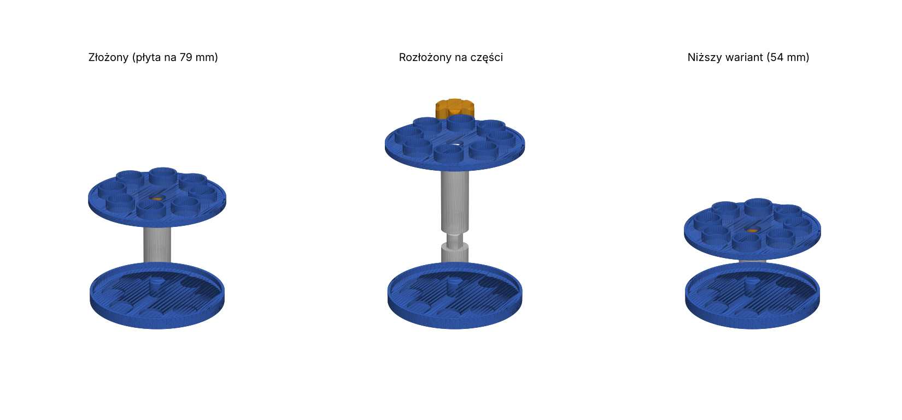

# Modułowy stojak na probówki

Przeróbka [Test tube rack](https://www.thingiverse.com/thing:5465490) autorstwa _Mayak_ (CC BY):
bez gwintów, z regulowaną wysokością, z barierkami i z częściami drukowanymi bez podpór.



## Części (`stl/`)

| Plik | Ile sztuk | Jak położyć na stole |
|---|---|---|
| `podstawa.stl` | 1 | płasko, czop do góry |
| `plyta_gorna.stl` | 1 | płasko, tuleje do góry |
| `kolumna_25mm.stl` / `kolumna_50mm.stl` | wg wysokości | pionowo, gniazdo na dole (tak jak w pliku) |
| `nakretka.stl` | 1 | gniazdem do stołu (tak jak w pliku) |

**Wysokość górnej płyty = 4 mm + suma segmentów kolumny:**

| Segmenty | Płyta na wysokości | Pasuje do probówek |
|---|---|---|
| 50 | 54 mm | ~75–90 mm |
| 25 + 50 | 79 mm | ~100–120 mm |
| 50 + 50 | 104 mm | ~150 mm |
| 25 + 50 + 50 | 129 mm | ~180–200 mm |

## Co jest inaczej niż w oryginale

- **Brak gwintów.** Części łączą się na czop w kształcie litery D (Ø12 mm) wciskany w gniazdo.
  Płaska ścianka blokuje obrót, więc otwory w górnej płycie zawsze są nad gniazdami w podstawie.
- **Regulowana wysokość.** Kolumna składa się z segmentów 25 i 50 mm.
- **Barierki.** Rant 8 mm na brzegu podstawy (nic nie spadnie ani się nie rozleje),
  tuleje 10 mm wokół każdego otworu w górnej płycie (probówki stoją prosto) i niski rant na jej brzegu.
- **Gniazda w podstawie** to zagłębienia 2 mm na dno probówki.
- **Wszystko drukuje się bez podpór**, a największa część ma 100 × 100 mm.
- 8 miejsc na probówki Ø16 mm (otwory 17,5 mm).

## Ustawienia druku

- PLA lub PETG, warstwa 0,2 mm, 3 obrysy, wypełnienie 20%. Kolumny i czopy najlepiej 4 obrysy.
- Bez podpór. Brim niepotrzebny.
- Jeśli czop wchodzi za ciasno: przeszlifuj go lekko albo zwiększ `LUZ_PASOWANIA` w `stojak.py` do 0.25–0.3.
  Jeśli za luźno: zmniejsz do 0.15.

## Zmiana wymiarów

Wszystkie wymiary są na górze pliku `stojak.py` (średnica probówek, liczba miejsc, średnica płyt,
wysokość barierek, długości segmentów, luz pasowania). Po zmianie:

```
pip install manifold3d trimesh numpy
python stojak.py stl
```
